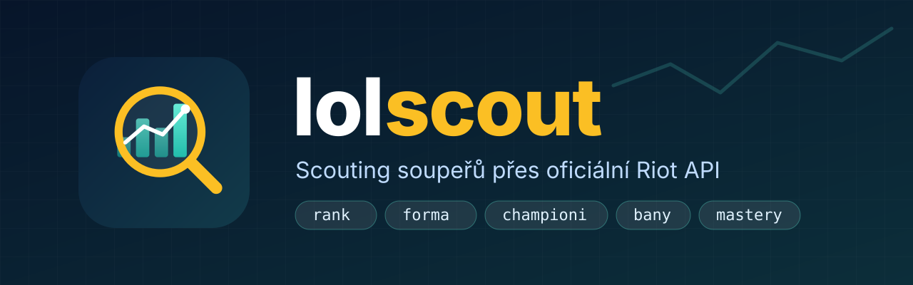

<p align="center"></p>

# lolscout

Scouting soupeřů v League of Legends přes **oficiální Riot API**. Zadáš zápas soupeře nebo jména hráčů a dostaneš Markdown report: rank, formu, role, nejhranější championy, mastery a kandidáty na ban.

```
python lolscout.py EUN1_4023742408 --us "MujNick#EUNE"
→ scout_2026-11-12_1716.md
```

## Ukázka výstupu

```markdown
| Hráč | Hlavní role | Solo/Duo | WR | Forma (10) | Top championi |
|---|---|---|---|---|---|
| JungleHrac#EUNE | Jungle | Gold II | 50 % | `LWLWLLWLWL` | Jarvan IV (11), Lee Sin (6), Wukong (3) |
| AdcHrac#EUNE | ADC | Master | 60 % | `WWLWLLWLLW` | Vayne (19), Kai'Sa (1) |

### Kandidáti na ban
1. **Vayne** – AdcHrac#EUNE: 19 her, 58 % WR
2. **Thresh** – SuppHrac#EUNE: 11 her, 73 % WR
```

U každého hráče report dál uvádí:
- rank v Solo/Duo i Flexu,
- championa, roli a KDA z vašeho zápasu,
- winrate, KDA a CS/min,
- rozložení rolí a tabulku championů,
- mastery top 5,
- upozornění na one-tricky a hráče, kteří dlouho nehráli,
- odkaz na op.gg.

## Instalace

```bash
python3 -m venv .venv && source .venv/bin/activate
pip install -r requirements.txt
cp .env.example .env      # a vlož do něj svůj API klíč
```

### API klíč

1. Přihlas se na **https://developer.riotgames.com** svým Riot účtem.
2. Na dashboardu je hned **Development API Key** (`RGAPI-…`). Platí 24 hodin, pak ho tam obnovíš tlačítkem.
3. Pro trvalé používání zaregistruj produkt jako **Personal API Key** („Register Product" → Personal). Je určený právě pro osobní projekty a malé soukromé komunity.
4. Vlož klíč do `.env`: `RIOT_API_KEY=RGAPI-...`

Klíč nikdy necommituj. `.env` je v `.gitignore`. Podle pravidel Riotu ho smíš sdílet jen se spoluhráči.

## Použití

**Ze zápasu soupeře** (nejspolehlivější, protože vrací přesná Riot ID včetně náhradníků):

Na Challengermode otevři **odehraný** zápas soupeře. V sekci Lineups je řádek *Riot match ID: EUN1_…*.

```bash
python lolscout.py EUN1_4023742408 --us "MujNick#EUNE"
```
`--us` určí, kdo jste vy, a nástroj vezme druhý tým. Abys to nemusel psát pokaždé, nastav do `.env` třeba `LOLSCOUT_US=MujNick#EUNE,Spoluhrac#EUNE`.

Víc zápasů najednou, například z několika předchozích kol soupeře:
```bash
python lolscout.py EUN1_111 EUN1_222 --side red
```

**Z Riot ID:**
```bash
python lolscout.py "Hrac1#EUNE" "Hrac2#EUNE" "Hrac3#EUNE"
```

### Přepínače

| Přepínač | Význam |
|---|---|
| `--us "Nick#TAG"` | Hráč z vašeho týmu. Ze zápasu se pak scoutuje soupeř. Lze opakovat. |
| `--side blue\|red\|both` | Který tým ze zápasu, když není `--us` (výchozí oba). |
| `--games N` | Kolik posledních her analyzovat (výchozí 20, max 100). |
| `--queue ranked\|solo\|flex\|all` | Které fronty počítat (výchozí ranked = solo + flex). |
| `--region eune` | Region (eune, euw, na, kr, …). |
| `-o soubor.md` | Výstupní soubor. |
| `--json data.json` | Uloží i spočítaná data (pro další zpracování). |
| `--no-mastery` | Nestahovat mastery (o 1 požadavek na hráče méně). |
| `--production-limits` | Pokud máš production klíč s vyššími limity. |

## Hloubková analýza jednoho hráče

`player-scout.py` rozebere jednoho hráče podle Riot ID podrobněji než týmový report:

```bash
python player-scout.py "Hrac#EUNE"
python player-scout.py "Hrac#EUNE" --games 100 --queue solo --json hrac.json
→ scout_Hrac-EUNE_2026-11-14_2130.md
```

Report obsahuje:
- rank, level účtu a upozornění na možný smurf (nízký level a vysoký rank),
- souhrn: WR, KDA, kill participation, podíl na poškození týmu, poškození, CS, gold a vision za minutu, control wardy,
- formu, aktuální sérii, trend posledních 10 her a kdy a jak často hraje,
- role a champion pool s WR, KDA, CS/min, DMG/min a KP u každého championa,
- mastery top 10 a pocket picky (vysoká mastery, ale v analyzovaných hrách je nehrál),
- lajnovací fázi: CS v 10. minutě, náskok v gold+XP, solo killy, first blood,
- srovnání výher a proher a winrate podle délky hry,
- soupeře v lajně a opakované spoluhráče (pravděpodobné duo nebo premade),
- postřehy pro draft s kandidáty na ban a tabulku posledních 15 her.

Přepínače jsou stejné jako u `lolscout.py` (`--games`, `--queue`, `--region`, `-o`, `--json`, `--no-mastery`, `--production-limits`). Jen `--games` má výchozí hodnotu 50. Jeden běh stojí zhruba `--games` + 5 požadavků, takže s personal klíčem trvá 50 her pár sekund a 100 her kolem 2 minut. Sdílí `.env` i `.lolscout-cache/` s `lolscout.py`.

## Jak to funguje

1. Ze zápasu (Match-V5) vezme 10 hráčů a podle `--us` nebo `--side` vybere soupeře.
2. Pro každého stáhne ID posledních N her, detaily těch her, ranked údaje (League-V4) a mastery (Champion-Mastery-V4).
3. Z jeho záznamů ve hrách spočítá statistiky. Remaky (hry pod 5 minut) přeskočí.
4. Jména championů doplní z Riot Data Dragon (veřejné, bez klíče).

**Rychlost:** personal klíč má limit 20 požadavků za sekundu a 100 za 2 minuty. Pět hráčů po 20 hrách je zhruba 115 požadavků, tedy kolem 2 minut. Nástroj limity hlídá sám a při chybě 429 počká. Stažené zápasy ukládá do `.lolscout-cache/`, takže opakovaný běh je skoro okamžitý.

## Omezení

- Riot API nezná týmy z Challengermode. Lineup proto bereš z **odehraného** zápasu soupeře (Riot match ID), nebo zadáš Riot ID ručně.
- **Custom/turnajové hry** (queue 0) se do statistik nepočítají, pokud nepoužiješ `--queue all`. Podle pravidel Riotu se jejich historie nesmí veřejně zobrazovat bez souhlasu hráče, takže reporty nech jen pro tým.
- Personal klíč nesmí pohánět veřejnou aplikaci. Pro web nebo bota pro cizí lidi je potřeba production klíč.
- Cache v `.lolscout-cache/` platí jen pro klíče jedné aplikace v Riot Developer Portalu (PUUID hráčů jsou šifrované pro každou aplikaci zvlášť). Po přechodu na klíč jiné aplikace skončí běh chybou o nerozšifrovaném PUUID – starou cache přesuň stranou (`mv .lolscout-cache .lolscout-cache.old`).

---

lolscout isn't endorsed by Riot Games and doesn't reflect the views or opinions of Riot Games or anyone officially involved in producing or managing Riot Games properties. Riot Games, and all associated properties are trademarks or registered trademarks of Riot Games, Inc.
